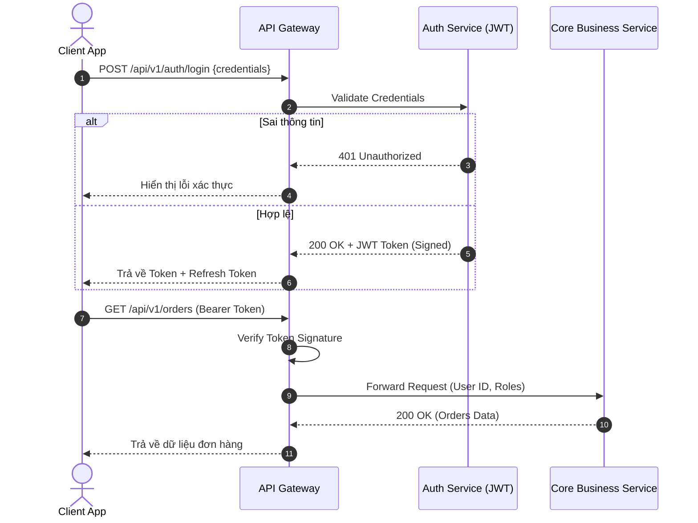
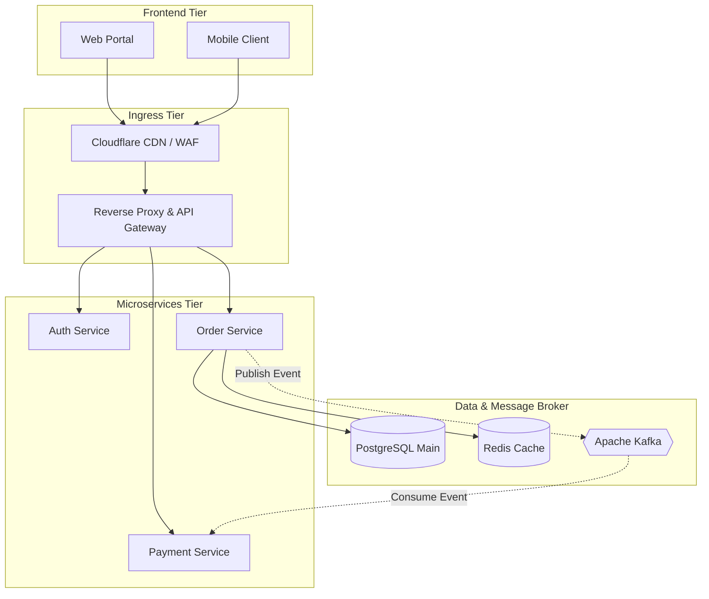

# Sơ đồ Kiến trúc & Luồng Tương tác

Trang này mô tả chi tiết quy trình xử lý của API Gateway và hệ thống Backend thông qua sơ đồ Mermaid.

## 1. Sơ đồ tuần tự xác thực (Authentication Sequence)



## 2. Kiến trúc xử lý luồng dữ liệu (Dataflow Architecture)



## 3. Cấu hình biến môi trường mẫu

Dưới đây là tệp khai báo chuẩn kết nối cho dịch vụ API Gateway:

```yaml
server:
  port: 8080
  contextPath: /api/v1

security:
  jwt:
    issuer: auth.company.internal
    expirationTime: 3600 # 1 giờ
    publicKeyPath: /etc/secrets/jwt_public.pem

database:
  host: pg-cluster.internal
  port: 5432
  name: order_db
  pool:
    maxSize: 20
    minIdle: 5
```
